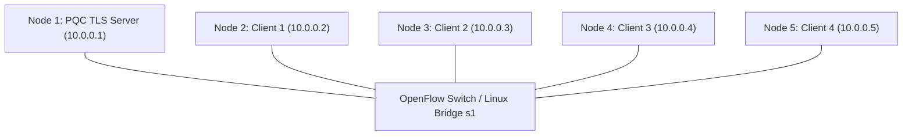

# KẾ HOẠCH TRIỂN KHAI: GIẢ LẬP MẠNG 5 NODE TLS 1.3 KẾT HỢP PQC & PHÂN TÍCH 1000 PHIÊN BẮT GÓI TIN

---

## 1. TỔNG QUAN VÀ MỤC TIÊU DỰ ÁN

### 1.1. Mục tiêu chính
- **Xây dựng mô hình mạng 5 node**: Gồm 1 Server và 4 Client (hoặc 1 Server, 1 Gateway/Router và 3 Client), mô phỏng truyền thông mạng thực tế với độ trễ và băng thông được kiểm soát.
- **Ứng dụng giao thức TLS 1.3 kết hợp Mật mã hậu lượng tử (PQC - Post-Quantum Cryptography)**:
  - Trao đổi khóa (Key Encapsulation Mechanism - KEM): Chuẩn NIST ML-KEM (Kyber-512 / Kyber-768) hoặc Hybrid KEM (`X25519Kyber768Draft00` / `p256_kyber768`).
  - Chữ ký số / Xác thực (Digital Signature Algorithm): Chuẩn NIST ML-DSA (Dilithium2 / Dilithium3) hoặc Falcon-512.
- **Thực thi và giám sát 1000 lượt trao đổi**:
  - Tự động hóa gửi nhận 1000 phiên TLS 1.3 PQC giữa các Client và Server.
  - Sử dụng `tcpdump` / `tshark` bắt trọn gói tin vào file lưu trữ chuẩn `.pcap`.
- **Phân tích dữ liệu & Trực quan hóa bằng biểu đồ**:
  - Trích xuất các tham số đo lường mạng và mật mã.
  - Tạo các biểu đồ thống kê chuyên sâu: độ trễ bắt tay (handshake latency), kích thước các bản tin TLS, phân bố kích thước gói, thông lượng (throughput) và so sánh với TLS 1.3 cổ điển (Classical TLS).

---
### 1.2. Quy tắc phải thực hiện theo
- Sau khi thực hiện xong giai đoạn nào sẽ ghi nhận lại vào file process.md, khi bắt đầu thực thi mới cần đọc file process.md để tiếp tục thực thi 
- Không được thêm command vào code
- Sắp xếp các file code vào thư mục một cách khoa học
## 2. KIẾN TRÚC MẠNG VÀ MÔ HÌNH 5 NODE

### 2.1. Topo mạng (Mininet / Linux Network Namespaces)
Hệ thống sử dụng **Mininet** (hoặc Linux Network Namespaces `ip netns`) trên nền WSL2 Ubuntu:



### 2.2. Phân vai và tải của từng Node (1000 lượt trao đổi)
| Node | Tên định danh | Địa chỉ IP | Vai trò | Số lượng phiên (Sessions) |
| :--- | :--- | :--- | :--- | :--- |
| **Node 1** | `srv` (Server) | `10.0.0.1` | PQC TLS 1.3 Server (Echo / API Service) | Lắng nghe & xử lý 1000 requests |
| **Node 2** | `client_1` | `10.0.0.2` | PQC TLS Client gửi request | 250 requests |
| **Node 3** | `client_2` | `10.0.0.3` | PQC TLS Client gửi request | 250 requests |
| **Node 4** | `client_3` | `10.0.0.4` | PQC TLS Client gửi request | 250 requests |
| **Node 5** | `client_4` | `10.0.0.5` | PQC TLS Client gửi request | 250 requests |
| **Tổng cộng**| - | - | - | **1000 lượt trao đổi thành công** |

### 2.3. Cấu hình đặc tính đường truyền (QoS / Netem)
Để mô phỏng môi trường mạng thực tế (LAN / WAN nhẹ):
- **Băng thông (Bandwidth)**: 100 Mbps.
- **Độ trễ (Latency/Delay)**: 10 ms (Jitter: ± 2 ms).
- **Tỷ lệ suy hao gói tin (Packet Loss)**: 0.1% (hoặc 0% để chuẩn hóa đo đạc ban đầu).

---

## 3. NGĂN XẾP CÔNG NGHỆ VÀ GIAO THỨC PQC TLS 1.3

### 3.1. Cấu hình Mật mã hậu lượng tử
- **Thư viện nền tảng**:
  - **OpenSSL 3.x** tích hợp **Open Quantum Safe (`oqs-provider` / `liboqs`)** hoặc module **Python-OQS / Go PQC TLS**.
- **Thuật toán áp dụng**:
  - **KEM (Trao đổi khóa)**:
    - *Lựa chọn 1 (Hybrid chuẩn công nghiệp)*: `x25519_kyber768` (kết hợp X25519 cổ điển và Kyber768 hậu lượng tử).
    - *Lựa chọn 2 (Thuần PQC)*: `kyber768` (ML-KEM-768).
  - **Xác thực / Chữ ký số (Authentication & Signature)**:
    - `dilithium3` (ML-DSA-65) hoặc `dilithium2` cho chứng chỉ Root CA và Server Certificate.
  - **Cipher Suite**: `TLS_AES_256_GCM_SHA384` hoặc `TLS_CHACHA20_POLY1305_SHA256`.

### 3.2. Quy trình Handshake TLS 1.3 PQC
1. **ClientHello**:
   - Gửi `KeyShare` chứa Public Key của thuật toán PQC KEM (Kyber768 có kích thước ~1184 bytes, lớn hơn nhiều so với X25519 chỉ 32 bytes).
   - Danh sách `supported_groups` bao gồm nhóm PQC.
2. **ServerHello**:
   - Server chọn thuật toán PQC KEM, gửi `KeyShare` (Ciphertext ~1088 bytes).
   - Gửi chứng chỉ số PQC Server Certificate (chứa Public Key Dilithium ~1952 bytes và Signature Dilithium ~3293 bytes).
   - Gửi `CertificateVerify` và `Finished`.
3. **Client Finished & Trao đổi dữ liệu (Application Data)**:
   - Client hoàn tất xác thực và gửi HTTP/Echo payload được mã hóa đối xứng.
   - Server phản hồi kết quả và đóng hoặc duy trì kết nối.

---

## 4. QUY TRÌNH THU THẬP VÀ PHÂN TÍCH GÓI TIN (PACKET CAPTURE)

### 4.1. Cơ chế bắt gói tin
- Công cụ: `tcpdump` chạy nền trên interface của Switch (`s1`) hoặc interface của Server (`srv-eth0`).
- Lệnh bắt:
  ```bash
  tcpdump -i any -s 0 -w captures/tls_pqc_1000_sessions.pcap "tcp port 4433"
  ```
- Định dạng xuất: File `.pcap` chuẩn có thể đọc trực tiếp bằng Wireshark, TShark, Scapy, Pyshark.

### 4.2. Các trường dữ liệu trích xuất từ 1000 phiên
1. **Timestamp & Round Trip Time (RTT)**:
   - TCP 3-way handshake time ($T_{syn} \rightarrow T_{ack}$).
   - TLS Handshake duration ($T_{ClientHello} \rightarrow T_{Finished}$).
   - Application Round-Trip Time ($T_{Request} \rightarrow T_{Response}$).
   - Tổng thời gian hoàn tất phiên (Total Session Latency).
2. **Dung lượng và kích thước gói tin (Packet & Payload Sizes)**:
   - Kích thước frame Ethernet thô.
   - Kích thước bản tin `ClientHello` (kèm PQC KeyShare).
   - Kích thước chuỗi bản tin `ServerHello` + `Certificate` + `CertificateVerify` (hiện tượng phân mảnh TCP IP Fragmentation do chứng chỉ PQC lớn).
   - Tổng số bytes truyền/nhận trên mỗi phiên.
3. **Thống kê gói**:
   - Số lượng packet TCP trên mỗi phiên TLS.
   - Tần suất các cờ TCP (SYN, ACK, PSH, FIN).
   - Hiện tượng retransmission / out-of-order (nếu có).

---

## 5. CÁC BIỂU ĐỒ ĐƯỢC TẠO RA (DATA VISUALIZATION)

Sử dụng `Python` (`matplotlib`, `seaborn`, `pandas`) để sinh bộ biểu đồ khoa học chất lượng cao:

| STT | Tên biểu đồ | Loại đồ thị | Mục đích thể hiện |
| :---: | :--- | :--- | :--- |
| **1** | **TLS Handshake Latency Distribution** | Histogram + KDE / Boxplot | Phân bố thời gian hoàn tất bắt tay TLS 1.3 PQC qua 1000 lượt (Mean, Median, 95th/99th percentile). |
| **2** | **TLS Message Size Breakdown** | Grouped Bar Chart | So sánh dung lượng chi tiết: ClientHello, ServerHello, Certificate (PQC vs Cổ điển RSA/ECDSA). |
| **3** | **Network Packet Size Distribution** | CDF (Cumulative Distribution Function) | Phân bố kích thước tất cả gói tin IP bắt được trong 1000 phiên (thấy rõ các gói đầy MTU 1500 bytes do phân mảnh PQC). |
| **4** | **Latency Timeline Across 1000 Exchanges** | Scatter Plot + Moving Average | Độ ổn định thời gian phản hồi qua 1000 lượt trao đổi liên tiếp từ 4 node client. |
| **5** | **Throughput & Bandwidth Utilization** | Line Chart over Time | Lưu lượng băng thông tiêu thụ (KB/s hoặc Mbps) trong suốt thời gian diễn ra bài test. |
| **6** | **Packets per Session & TCP Overhead** | Violin Plot / Bar Chart | Số lượng packet thực tế cần thiết cho 1 handshake TLS PQC so với TLS tiêu chuẩn. |
| **7** | **PQC vs Classical TLS Comparison Chart** | Spider/Radar Chart hoặc Comparison Bar | Đánh giá tổng hợp: Handshake time, Certificate size, Key exchange size, CPU cost. |

---

## 6. LỘ TRÌNH THỰC HIỆN CHI TIẾT (STEP-BY-STEP ROADMAP)

### Giai đoạn 1: Chuẩn bị Môi trường & Thư viện PQC
- [x] Kiểm tra và cài đặt các phụ thuộc cần thiết trên WSL Ubuntu (Python3, Pip, Scapy, Matplotlib, Pandas, Tshark/Tcpdump).
- [x] Thiết lập OpenSSL 3 có hỗ trợ PQC (sử dụng Open Quantum Safe `liboqs` + `oqs-provider` hoặc bộ giả lập TLS 1.3 Kyber/Dilithium chuyên dụng).
- [x] Kiểm tra khả năng bắt tay TLS 1.3 với cipher PQC độc lập.

### Giai đoạn 2: Tạo Khóa & Chứng chỉ PQC (PKI Setup)
- [x] Khởi tạo Root CA PQC (sử dụng thuật toán chữ ký ML-DSA / Dilithium3).
- [x] Ký và phát hành chứng chỉ số TLS Server Certificate sử dụng Dilithium.
- [x] Cấu hình xác thực chuỗi chứng chỉ (Certificate Chain verification).

### Giai đoạn 3: Xây dựng Kịch bản Mạng 5 Node (Mininet / Namespaces)
- [x] Viết script khởi tạo topo mạng gồm 5 node: 1 Server (`10.0.0.1`), 4 Client (`10.0.0.2` - `10.0.0.5`) kết nối qua Switch ảo.
- [x] Cấu hình thuộc tính đường truyền (độ trễ 10ms, băng thông 100Mbps).
- [x] Kiểm tra kết nối ICMP ping thông suốt giữa toàn bộ 5 node.

### Giai đoạn 4: Viết Client/Server TLS 1.3 PQC & Tự động hóa 1000 Lượt
- [x] Viết chương trình Server: Lắng nghe cổng 4433, hỗ trợ TLS 1.3 với nhóm PQC KEM (Kyber768).
- [x] Viết chương trình Client: Hỗ trợ gửi yêu cầu theo từng đợt (batch) hoặc đồng thời (concurrency), tự động ghi nhận thời gian từng phiên.
- [x] Tích hợp script điều phối: Khởi động `tcpdump`, kích hoạt 4 Client thực hiện tổng cộng 1000 phiên, đảm bảo 100% phiên thành công, dừng bắt gói tin.

### Giai đoạn 5: Trích xuất Dữ liệu từ PCAP & Xử lý Thống kê
- [x] Xây dựng công cụ phân tích tự động bằng `scapy` / `pyshark` đọc file `.pcap`.
- [x] Trích xuất các mốc thời gian: TCP Handshake, TLS Handshake, Time to First Byte (TTFB), Total Latency.
- [x] Trích xuất kích thước các gói: Frame length, TCP payload, TLS record length.
- [x] Xuất dữ liệu sạch ra định dạng `benchmark_results.csv` và `packet_metrics.json`.

### Giai đoạn 6: Vẽ Biểu đồ Trực quan & Báo cáo Tổng kết
- [x] Viết kịch bản Python sinh toàn bộ 6 - 7 biểu đồ theo danh mục ở Mục 5, lưu dưới dạng file ảnh độ nét cao (`.png`).
- [x] Tính toán các chỉ số thống kê (Mean, Median, Standard Deviation, Min, Max, 95th Percentile).
- [x] Lập báo cáo tóm tắt phân tích hiệu năng và so sánh tác động của PQC đối với mạng máy tính.

---

## 7. KẾT QUẢ ĐẦU RA DỰ KIẾN (DELIVERABLES)
1. **`plan.md`**: Bản kế hoạch triển khai chi tiết (tài liệu này).
2. **Thư mục mã nguồn `src/`**:
   - `topology.py`: Script khởi tạo mạng 5 node và điều phối kiểm thử.
   - `server_pqc.py`: Server TLS 1.3 PQC.
   - `client_pqc.py`: Client TLS 1.3 PQC.
   - `generate_certs.sh`: Script sinh chứng chỉ PQC (Kyber/Dilithium).
3. **Thư mục dữ liệu `captures/` & `data/`**:
   - `tls_pqc_1000.pcap`: File bắt gói tin 1000 phiên nguyên bản.
   - `metrics.csv`: Dữ liệu phân tích chi tiết từng phiên.
4. **Thư mục biểu đồ `charts/`**:
   - `handshake_latency.png`
   - `packet_size_distribution.png`
   - `message_breakdown.png`
   - `latency_over_time.png`
   - `throughput_over_time.png`
   - `summary_comparison.png`
5. **`REPORT.md`**: Báo cáo tổng kết phân tích kỹ thuật và số liệu định lượng.

